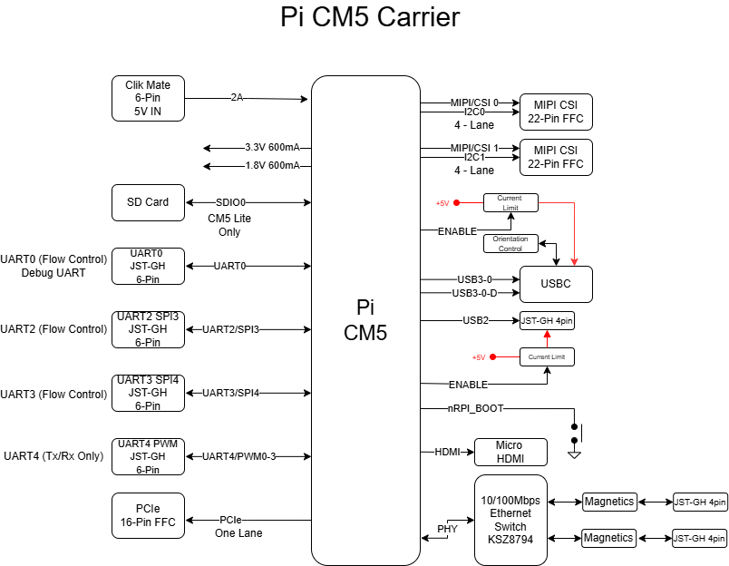

# Hardware Reference

## Specifications

| Specification | Value |
|---------------|-------|
| Compute module | Raspberry Pi [Compute Module 5](https://www.raspberrypi.com/products/compute-module-5/); [Compute Module 4](https://www.raspberrypi.com/products/compute-module-4/) with the [limits below](#compute-module-4) |
| Storage | microSD slot for Lite modules (no eMMC); modules with eMMC boot from their eMMC |
| Ethernet | Built-in switch with two 100 Mbps ports (4-pin JST-GH) |
| USB | USB-C, dual role, USB 3.0; 4-pin JST-GH, USB 2.0 |
| Cameras | 2× MIPI CSI, 22-pin 0.5 mm FFC, Raspberry Pi 5 CSI pinout |
| PCIe | PCIe x1, 16-pin FFC, Raspberry Pi 5 PCIe pinout |
| Display | Micro HDMI |
| UARTs and GPIO | UART0 debug/GPIO, UART2/SPI3/GPIO, UART3/SPI4/GPIO, UART4/PWM/GPIO (6-pin JST-GH each) |
| Fan | 4-pin JST-SH, Raspberry Pi 5 fan pinout |
| Power | 5 V, 2 A minimum, through a 6-pin Molex CLIK-Mate with I2C that matches [ARK PAB power modules](https://arkelectron.com/product-category/power/) |

## Compute Module 4

A CM4 fits, but these interfaces don't work with it:

* CAM2 (MIPI1)
* UART2
* USB-C
* PCIe
* Fan

With a CM4, the camera on CAM1 is the overlay default in `config.txt` (no `cam0` parameter), and the UART3 and UART4 connectors are uart4 (`/dev/ttyAMA4`) and uart5 (`/dev/ttyAMA5`).

## PCIe

* Gen 2 (default, tested). Set `dtparam=pciex1_gen=3` in [`config.txt`](flashing-guide/after-flashing-before-installing.md) for Gen 3 (untested).
* The 5 V pins are fed through a load switch limited to 1.5 A. The Compute Module's `PCIE_PWR_EN` turns the switch on and is also routed to pin 13, so the adapter can use it to enable its own regulator.

## Pinout

<figure><figcaption></figcaption></figure>

<figure><figcaption></figcaption></figure>



### Power — 6-pin 2.00 mm Molex [CLIK-Mate 502443](https://www.molex.com/en-us/part-list/502443)

Mating plug [5024390600](https://www.digikey.com/en/products/detail/molex/5024390600/2380425)

Pre-crimped wires [0797581014](https://www.digikey.com/en/products/detail/molex/0797581014/6346648)

| Pin | Signal | Voltage |
|---|---|---|
| 1 | VDD_5V_IN | 5.0V |
| 2 | VDD_5V_IN | 5.0V |
| 3 | PI_SCL1_PWR_EXT | 3.3V |
| 4 | PI_SDA1_PWR_EXT | 3.3V |
| 5 | GND | GND |
| 6 | GND | GND |

### Fan — 4-pin JST-SH

| Pin | Signal | Voltage |
|---|---|---|
| 1 | VDD_5V_IN | 5.0V (500mA) |
| 2 | FAN_PWM | 5.0V |
| 3 | GND | GND |
| 4 | FAN_TACHO | 5.0V |

### UART0 Debug/GPIO — 6-pin JST-GH

| Pin | Signal | Voltage |
|---|---|---|
| 1 | VDD_5V_IN | 5.0V (500mA) |
| 2 | UART0_TX/GPIO14 | 3.3V |
| 3 | UART0_RX/GPIO15 | 3.3V |
| 4 | UART0_CTS/GPIO16 | 3.3V |
| 5 | UART0_RTS/GPIO17 | 3.3V |
| 6 | GND | GND |

### UART2/SPI3/GPIO — 6-pin JST-GH

| Pin | Signal | Voltage |
|---|---|---|
| 1 | VDD_5V_IN | 5.0V (500mA) |
| 2 | UART2_TXD/SPI3_CSn/GPIO4 | 3.3V |
| 3 | UART2_RXD/SPI3_MISO/GPIO5 | 3.3V |
| 4 | UART2_CTS/SPI3_MOSI/GPIO6 | 3.3V |
| 5 | UART2_RTS/SPI3_SCLK/GPIO7 | 3.3V |
| 6 | GND | GND |

### UART3/SPI4/GPIO — 6-pin JST-GH

| Pin | Signal | Voltage |
|---|---|---|
| 1 | VDD_5V_IN | 5.0V (500mA) |
| 2 | UART3_TXD/SPI4_CSn/GPIO8 | 3.3V |
| 3 | UART3_RXD/SPI4_MISO/GPIO9 | 3.3V |
| 4 | UART3_CTS/SPI4_MOSI/GPIO10 | 3.3V |
| 5 | UART3_RTS/SPI4_SCLK/GPIO11 | 3.3V |
| 6 | GND | GND |

### UART4/PWM/GPIO — 6-pin JST-GH

| Pin | Signal | Voltage |
|---|---|---|
| 1 | VDD_5V_IN | 5.0V (500mA) |
| 2 | UART4_TXD/PWM0/GPIO12 | 3.3V |
| 3 | UART4_RXD/PWM1/GPIO13 | 3.3V |
| 4 | PWM2/GPIO18 | 3.3V |
| 5 | PWM3/GPIO19 | 3.3V |
| 6 | GND | GND |

Pin 4 is a GNSS PPS input by default; see [PPS Input](pps-input.md).

### CAM1 (MIPI0) — 22-pin 0.5 mm FFC

| Pin | Signal | Voltage |
|---|---|---|
| 1 | GND | GND |
| 2 | MIPI0_D0_N | 1.2V |
| 3 | MIPI0_D0_P | 1.2V |
| 4 | GND | GND |
| 5 | MIPI0_D1_N | 1.2V |
| 6 | MIPI0_D1_P | 1.2V |
| 7 | GND | GND |
| 8 | MIPI0_C_N | 1.2V |
| 9 | MIPI0_C_P | 1.2V |
| 10 | GND | GND |
| 11 | MIPI0_D2_N | 1.2V |
| 12 | MIPI0_D2_P | 1.2V |
| 13 | GND | GND |
| 14 | MIPI0_D3_N | 1.2V |
| 15 | MIPI0_D3_P | 1.2V |
| 16 | GND | GND |
| 17 | CAM_GPIO0 | 3.3V |
| 18 | CAM_GPIO1 | 3.3V |
| 19 | GND | GND |
| 20 | SCL0 | 3.3V |
| 21 | SDA0 | 3.3V |
| 22 | VDD_3V3_CAMERA | 3.3V (1A) |

### CAM2 (MIPI1) — 22-pin 0.5 mm FFC

| Pin | Signal | Voltage |
|---|---|---|
| 1 | GND | GND |
| 2 | MIPI1_D0_N | 1.2V |
| 3 | MIPI1_D0_P | 1.2V |
| 4 | GND | GND |
| 5 | MIPI1_D1_N | 1.2V |
| 6 | MIPI1_D1_P | 1.2V |
| 7 | GND | GND |
| 8 | MIPI1_C_N | 1.2V |
| 9 | MIPI1_C_P | 1.2V |
| 10 | GND | GND |
| 11 | MIPI1_D2_N | 1.2V |
| 12 | MIPI1_D2_P | 1.2V |
| 13 | GND | GND |
| 14 | MIPI1_D3_N | 1.2V |
| 15 | MIPI1_D3_P | 1.2V |
| 16 | GND | GND |
| 17 | Pulled up to 3.3V via 1.5k Ohm Resistor | 3.3V |
| 18 | NC | NC |
| 19 | GND | GND |
| 20 | ID_SC | 3.3V |
| 21 | ID_SD | 3.3V |
| 22 | VDD_3V3_CAMERA | 3.3V (1A) |

### USB 2.0 — 4-pin JST-GH

| Pin | Signal | Voltage |
|---|---|---|
| 1 | USB2_VBUS | 5.0V (1A) |
| 2 | USB2_N | 3.3V |
| 3 | USB2_P | 3.3V |
| 4 | GND | GND |

### ETH1 — 4-pin JST-GH

| Pin | Signal | Voltage |
|---|---|---|
| 1 | EXT1_ETH_RX_N | Isolated |
| 2 | EXT1_ETH_RX_P | Isolated |
| 3 | EXT1_ETH_TX_N | Isolated |
| 4 | EXT1_ETH_TX_P | Isolated |

### ETH2 — 4-pin JST-GH

| Pin | Signal | Voltage |
|---|---|---|
| 1 | EXT2_ETH_RX_N | Isolated |
| 2 | EXT2_ETH_RX_P | Isolated |
| 3 | EXT2_ETH_TX_N | Isolated |
| 4 | EXT2_ETH_TX_P | Isolated |

### PCIe — 16-pin FFC (CF20161V0R0-NH)

| Pin | Signal | Voltage |
|---|---|---|
| 1 | 5V_PCIE_FFC | 5.0V (1.5A) |
| 2 | 5V_PCIE_FFC | 5.0V (1.5A) |
| 3 | GND | GND |
| 4 | PCIE_CLK_P | 1.0V |
| 5 | PCIE_CLK_N | 1.0V |
| 6 | GND | GND |
| 7 | PCIE_RX_P | 1.0V |
| 8 | PCIE_RX_N | 1.0V |
| 9 | GND | GND |
| 10 | PCIE_TX_P | 1.0V |
| 11 | PCIE_TX_N | 1.0V |
| 12 | GND | GND |
| 13 | PCIE_PWR_EN | 3.3V |
| 14 | PCIE_WAKEn | 3.3V |
| 15 | PCIE2_CLKREQn | 3.3V |
| 16 | PCIE2_RSTn | 3.3V |

## Block Diagram

<figure><figcaption>
ARK Just a Pi Block Diagram
</figcaption></figure>

## 3D Model and Case

| File | Contents |
|------|----------|
| [ARK\_Just\_a\_Pi.step](https://github.com/ARK-Electronics/ark-hardware/raw/main/ARK_Just_A_Pi/model/ARK_Just_a_Pi.step) | Board model |
| [Bottom\_Just\_a\_Pi\_Case.step](https://github.com/ARK-Electronics/ark-hardware/raw/main/ARK_Just_A_Pi/case/Bottom_Just_a_Pi_Case.step) | Case bottom |
| [Fan\_Top\_Just\_a\_Pi\_Case.step](https://github.com/ARK-Electronics/ark-hardware/raw/main/ARK_Just_A_Pi/case/Fan_Top_Just_a_Pi_Case.step) | Case top with fan opening |
| [No\_Fan\_Top\_Just\_a\_Pi\_Case.step](https://github.com/ARK-Electronics/ark-hardware/raw/main/ARK_Just_A_Pi/case/No_Fan_Top_Just_a_Pi_Case.step) | Case top without fan |

All files: [ARK\_Just\_A\_Pi in ark-hardware](https://github.com/ARK-Electronics/ark-hardware/tree/main/ARK_Just_A_Pi)
