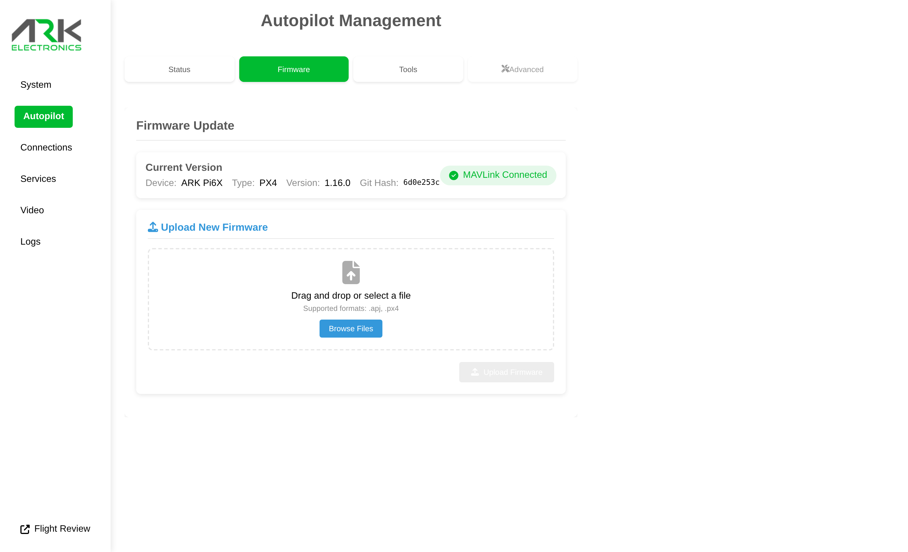

# Firmware

The flight controller runs PX4 1.15 or later, or ArduPilot 4.7 or later. The AFBR-S50LV85D distance sensor on the Pi6X Flow is not supported in ArduPilot.

| Firmware | Build target |
|----------|--------------|
| PX4 | `ark_pi6x_default` ([boards/ark/pi6x](https://github.com/PX4/PX4-Autopilot/tree/main/boards/ark/pi6x)) |
| ArduPilot | `ARK_PI6X` ([hwdef](https://github.com/ArduPilot/ardupilot/tree/master/libraries/AP_HAL_ChibiOS/hwdef/ARK_PI6X)) |

The flight controller's USB connects only to the Pi, so firmware is updated from the Pi.

## From the Web UI

Open the [ARK-UI](http://pi6x.local) **Autopilot** page, select the **Firmware** tab, and upload a `.px4` firmware file.

<figure><figcaption></figcaption></figure>

## From the Command Line

SSH into the Pi and run the ARK-OS flashing tool (on `PATH`). The update is performed over the USB connection:

```bash
flash_firmware.sh <firmware.px4>
```

## Downloads

* PX4: `ark_pi6x_default.px4` from the [PX4 releases page](https://github.com/PX4/PX4-Autopilot/releases/)
* ArduPilot: [firmware.ardupilot.org](https://firmware.ardupilot.org/), board `ARK_PI6X`

## Bootloader Recovery

If the flight controller does not enumerate over USB, recover the bootloader over SWD on the flight controller debug port: [ST-LINK Flashing Guide](../../knowledge-base/st-link-flashing-guide.md#flashing-px4-flight-controllers).
